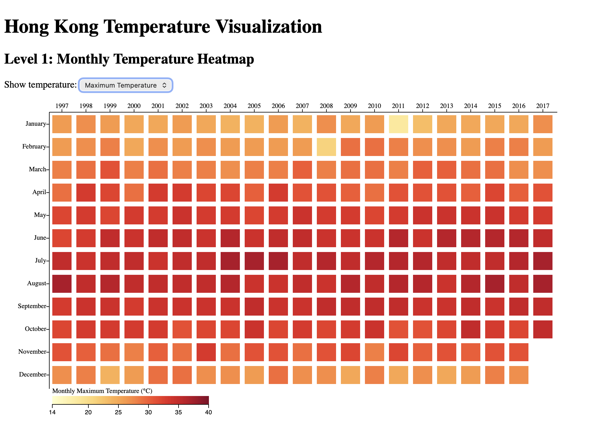
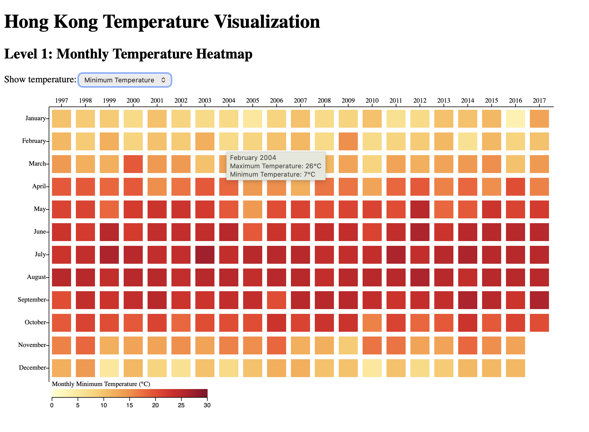

# Hong Kong Temperature Visualization

**CSCE 679: Data Visualization | Assignment 1**

## Project Overview

For this assignment, I created two interactive visualizations using D3.js to explore temperature data from Hong Kong between 1997 and 2017.

The idea was to make it easier to understand how temperatures change across different months and years. The first visualization gives an overall view of monthly temperatures, while the second provides a closer look at daily temperature changes.

## Level 1: Monthly Temperature Heatmap

In Level 1, I created a heatmap showing monthly temperatures from 1997 to 2017. Each cell represents one month in a particular year, and its color indicates the temperature.

The visualization includes a dropdown menu that lets users switch between maximum and minimum temperatures. I used a yellow-to-red color scale to show the temperature differences, along with a legend to help interpret the colors.

I also added hover tooltips so users can see the month, year, maximum temperature, and minimum temperature for individual cells.

This view makes it easier to compare temperatures across years and notice seasonal patterns.

## Level 2: Daily Temperature Visualization

For Level 2, I focused on the years 2008 to 2017 and added more detail to the monthly heatmap.

Each cell represents a month, with its background color showing the monthly maximum temperature. Inside the cells, green lines show daily maximum temperatures and cyan lines show daily minimum temperatures.

I also included a vertical color legend to explain the temperature scale.

This visualization helps show how temperatures vary within a month, rather than only looking at the overall monthly values.

## Dataset

I used the `temperature_daily.csv` dataset, which contains daily temperature observations for Hong Kong.

I processed the data using JavaScript and D3.js to calculate monthly temperature values and organize the daily measurements for both visualizations.

## Technologies Used

- **HTML** for the webpage structure
- **JavaScript** for processing the data and handling interactions
- **D3.js** for creating the visualizations
- **CSV** for storing the temperature data

## Live Interactive Visualization

[Click here to explore my visualizations](https://kgrvarshini-vr.github.io/CSCE-679-Temperature-Visualization/)

The live website allows users to interact with the visualizations, switch between temperature modes in Level 1, and explore the temperature patterns.

## Visualization Outputs

### Level 1: Maximum Temperature

This screenshot shows the monthly maximum temperature heatmap, including the temperature details displayed when hovering over a cell.

### Level 1: Minimum Temperature

This screenshot shows the same heatmap after switching to minimum temperatures using the dropdown menu.

### Level 2: Daily Temperature Visualization

This screenshot shows the monthly heatmap with daily maximum and minimum temperature lines.

### Level 2: Additional Output

This screenshot provides another view of the Level 2 visualization.

## How to Run

1. Download or clone this repository.
2. Open the project folder in Visual Studio Code.
3. Open `index.html` using the Live Server extension.
4. The visualizations will appear in the browser.

The project can also be viewed directly through the live website linked above.

## Project Files

| File | Description |
|---|---|
| `index.html` | HTML structure for the webpage |
| `script.js` | JavaScript and D3.js visualization code |
| `temperature_daily.csv` | Daily temperature dataset |
| `level1_output_max.png` | Level 1 maximum temperature screenshot |
| `level1_output_min.png` | Level 1 minimum temperature screenshot |
| `level 2_output.png` | Level 2 screenshot |
| `level 2_o:p.png` | Additional Level 2 screenshot |
| `README.md` | Project explanation and instructions |

## Conclusion

Through this assignment, I explored how different visualization approaches can present the same temperature data at different levels of detail. Level 1 makes it easier to compare monthly temperature patterns across years, while Level 2 shows how temperatures change from day to day.

Working with D3.js also helped me understand how to use color scales, line representations, and interactive features to make data easier to explore.
